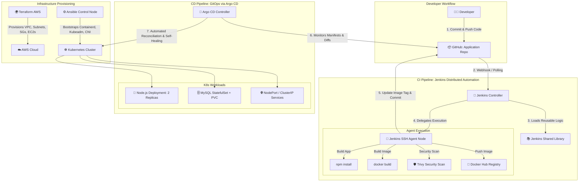

# 🚀 Production-Grade GitOps CI/CD Platform on AWS EKS / Self-Managed Kubernetes

[](./jenkins)
[](./argocd)
[](./terraform)
[](./ansible)
[](https://trivy.dev/)
[](./k8s-manifests)

An enterprise-ready, end-to-end DevOps project showcasing complete infrastructure provisioning, Kubernetes cluster bootstrapping via Kubeadm, containerized CI automation using Jenkins Agents & Shared Libraries, and continuous GitOps delivery powered by Argo CD.

---

## 📑 Table of Contents
1. [Architecture Overview](#-architecture-overview)
2. [Project Repository Layout](#-project-repository-layout)
3. [Component Breakdown](#-component-breakdown)
   - [Phase 1: Local Development & Docker Compose](#phase-1-local-development--docker-compose)
   - [Phase 2: Cloud Infrastructure with Terraform (AWS)](#phase-2-cloud-infrastructure-with-terraform-aws)
   - [Phase 3: Cluster Bootstrapping with Ansible & Kubeadm](#phase-3-cluster-bootstrapping-with-ansible--kubeadm)
   - [Phase 4: Kubernetes Declarative Manifests](#phase-4-kubernetes-declarative-manifests)
   - [Phase 5: Automated CI Pipeline (Jenkins Agent & Shared Library)](#phase-5-automated-ci-pipeline-jenkins-agent--shared-library)
   - [Phase 6: Continuous Delivery via Argo CD (GitOps)](#phase-6-continuous-delivery-via-argo-cd-gitops)
4. [Step-by-Step Setup & Verification Guide](#-step-by-step-setup--verification-guide)
5. [Production Best Practices & Security Highlights](#-production-best-practices--security-highlights)

---

## 🏛 Architecture Overview



---

## 📂 Project Repository Layout

```text
.
├── app/                           # Node.js Full-Stack Application source code
│   ├── frontend/                  # HTML/CSS/Vanilla JS UI
│   ├── server.js                  # Express backend
│   ├── db.js                      # MySQL pool connector & retry logic
│   ├── Dockerfile                 # Multi-stage container definition
│   └── package.json
├── docker-compose/                # Local emulation environment
│   └── docker-compose.yaml        # App + MySQL with health checks & isolated bridge network
├── terraform/                     # Modular AWS Infrastructure as Code
│   ├── environments/prod/         # Production deployment environment (VPC, Subnets, EC2s)
│   └── modules/
│       ├── vpc/                   # Custom VPC, Internet Gateway, Route Tables
│       ├── security/              # Fine-grained Security Groups (K8s API, NodePort, Internal CNI)
│       └── compute/               # EC2 Instances for Control Plane & Worker nodes
├── ansible/                       # Multi-Role Cluster Configuration Management
│   ├── ansible.cfg                # Ansible defaults & privilege escalation
│   ├── inventory.ini.example      # Cluster inventory template
│   ├── cluster-setup.yml          # Master orchestration playbook
│   └── roles/
│       ├── common/                # OS hardening, swap disabling, kernel modules, sysctl k8s tuning
│       ├── containerd/            # Container runtime setup with systemd cgroup driver
│       ├── kubernetes_base/       # Official pkgs.k8s.io repo, kubelet, kubeadm, kubectl
│       ├── master/                # kubeadm init, CNI Flannel rollout, join token extraction
│       └── worker/                # Worker node automated cluster join
├── k8s-manifests/                 # Declarative Kubernetes Manifests (GitOps Source of Truth)
│   └── base/
│       ├── namespace.yaml         # Dedicated ivolve namespace
│       ├── configmap.yaml         # Non-sensitive configuration (DB host, user)
│       ├── secret.yaml            # Sensitive credentials (passwords)
│       ├── db-statefulset.yaml    # MySQL StatefulSet with PVC storage claim
│       ├── app-deployment.yaml    # Node.js app deployment with DB initialization initContainer
│       └── kustomization.yaml     # Kustomize manifest bundle
├── jenkins/                       # Continuous Integration Assets
│   ├── Jenkinsfile                # Declarative pipeline invoking shared library
│   ├── agent/                     # Dockerized SSH build agent setup
│   │   └── compose.yaml           # Agent container mounting Docker socket, kubectl & node wrappers
│   └── shared-library/            # Modular Jenkins Shared Library repository
│       └── vars/
│           ├── buildJS.groovy             # Node.js build step
│           ├── buildScanPushImage.groovy  # Docker build + Trivy scan + DockerHub push
│           └── pushDeployment.groovy      # GitOps manifest updater & Git committer
└── argocd/                        # GitOps Continuous Delivery manifests
    └── application.yaml           # Declarative Argo CD Application with auto-sync & self-heal
```

---

## ⚙️ Component Breakdown

### Phase 1: Local Development & Docker Compose
Before deploying to the cloud, local developers can test the full application stack in isolation using Docker Compose:
- **Application (`app`)**: Node.js web server built locally on port `3000`.
- **Database (`mysql`)**: MySQL 8.0 configured with custom root & application user credentials.
- **Service Dependency & Healthcheck**: The application container depends on MySQL reaching a healthy state via `mysqladmin ping` before starting up.

```bash
docker compose -f docker-compose/docker-compose.yaml up -d --build
```

---

### Phase 2: Cloud Infrastructure with Terraform (AWS)
Located in [`terraform/`](./terraform), Terraform provisions the complete AWS foundation in region `eu-west-3`:
- **VPC Module**: Dedicated CIDR `172.31.0.0/16`, public subnets across 2 Availability Zones, Internet Gateway, and Route Tables.
- **Security Module**: Explicit security groups allowing SSH (`22`), Kubernetes API server (`6443`), NodePort service range (`30000-32767`), and unrestricted intra-cluster VPC traffic for CNI pod networking.
- **Compute Module**: Provisions Ubuntu 22.04 LTS instances for `master` (control-plane) and `worker` nodes with `gp3` storage.
- **Dynamic Inventory**: Generates an Ansible inventory file (`ansible/inventory.ini`) automatically upon `terraform apply`.

```bash
cd terraform/environments/prod
terraform init
terraform apply -auto-approve
```

---

### Phase 3: Cluster Bootstrapping with Ansible & Kubeadm
Located in [`ansible/`](./ansible), an automated multi-role Ansible playbook configures and bootstraps a multi-node Kubernetes cluster:
1. **Role: `common`**: Disables swap permanently, loads `overlay` and `br_netfilter` kernel modules, and enables `net.ipv4.ip_forward`.
2. **Role: `containerd`**: Installs Docker's `containerd.io`, generates default config, and enables `SystemdCgroup = true`.
3. **Role: `kubernetes_base`**: Configures the official Kubernetes repository (`pkgs.k8s.io`), installs `kubelet`, `kubeadm`, and `kubectl`, and holds package versions.
4. **Role: `master`**: Runs `kubeadm init`, configures kubeconfig permissions for the administrative user, deploys Flannel CNI, and exports join credentials.
5. **Role: `worker`**: Receives the join token from master and securely attaches to the cluster.

```bash
cd ansible
ansible-playbook -i inventory.ini cluster-setup.yml
```

---

### Phase 4: Kubernetes Declarative Manifests
Located in [`k8s-manifests/base/`](./k8s-manifests/base), all workloads follow cloud-native Kubernetes design patterns:
- **Namespace**: Workloads run inside an isolated `ivolve` namespace.
- **MySQL StatefulSet**: Stateful persistence guaranteed through PersistentVolumeClaims and stable network DNS (`ivolvedbsvc`).
- **Application Deployment**: 2 replicas with `initContainers` that continuously poll the database until ready, automatically provisioning schema and permissions before the application container boots.
- **Service Exposure**: NodePort service routing traffic from external port `30080` into container port `3000`.

---

### Phase 5: Automated CI Pipeline (Jenkins Agent & Shared Library)
The continuous integration pipeline is defined in [`jenkins/Jenkinsfile`](./jenkins/Jenkinsfile) and executes on a dedicated Jenkins SSH agent (`jenkins/ssh-agent:latest-jdk21`):
1. **Dynamic Workspace**: Runs inside agent container with direct access to Docker and Trivy security tools.
2. **Shared Library (`jenkins-shared-lib`)**:
   - `buildJS()`: Validates and installs dependencies (`npm install`).
   - `buildScanPushImage(...)`: Builds container image, executes a Trivy vulnerability scan checking for `HIGH,CRITICAL` CVEs, logs into Docker Hub using masked Jenkins credentials, and pushes the tagged image (`${BUILD_NUMBER}`).
   - `pushDeployment(...)`: Updates the image tag inside `k8s-manifests/base/app-deployment.yaml` and executes an authenticated Git commit and push back to GitHub.

---

### Phase 6: Continuous Delivery via Argo CD (GitOps)
Continuous deployment follows the **GitOps paradigm**:
- Argo CD monitors the Git repository at path `k8s-manifests/base`.
- Whenever the Jenkins CI stage commits a new image tag to GitHub, Argo CD's reconciliation loop detects the Git diff.
- **Automated Sync & Self-Healing**: Automatically synchronizes the new image to the cluster and corrects any manual drift in the cluster back to the state declared in Git.

---

## 🚀 Step-by-Step Setup & Verification Guide

### 1. Provision Cloud Infrastructure
```bash
cd terraform/environments/prod
cp terraform.tfvars.example terraform.tfvars
terraform init
terraform apply
```

### 2. Bootstrap Kubernetes Cluster
```bash
cd ../../../ansible
ansible-playbook -i inventory.ini cluster-setup.yml
```

Verify nodes on the master node:
```bash
kubectl get nodes -o wide
```

### 3. Deploy Argo CD to Cluster
```bash
kubectl create namespace argocd
kubectl apply -n argocd --server-side --force-conflicts -f https://raw.githubusercontent.com/argoproj/argo-cd/stable/manifests/install.yaml
```

Retrieve the Argo CD initial administrative password:
```bash
kubectl -n argocd get secret argocd-initial-admin-secret -o jsonpath="{.data.password}" | base64 -d; echo
```

### 4. Apply Argo CD Application
```bash
kubectl apply -f argocd/application.yaml
```

Verify application status in Argo CD:
```bash
kubectl get application ivolveapp -n argocd
```

### 5. Trigger Jenkins Pipeline
Trigger the Jenkins pipeline build. Observe:
1. Dependencies built and packaged.
2. Docker container built and scanned with Trivy.
3. Image pushed to Docker Hub (`marceleno17/ivolveapp:<BUILD_NUMBER>`).
4. Git commit pushed back to the repository.
5. Argo CD automatically deploying the updated image to the Kubernetes cluster.

Verify running pods and rollout status:
```bash
kubectl get pods,svc,deploy -n ivolve -o wide
```

---

## 🔒 Production Best Practices & Security Highlights
- **Least Privilege Access**: Dedicated Security Groups restrict SSH access, and cluster communications are confined to VPC internals.
- **Shift-Left Security**: Container vulnerability scanning with Trivy in CI prevents vulnerable images from being deployed.
- **Decoupled CI/CD**: Jenkins strictly handles building, testing, scanning, and updating code/manifests. Jenkins is never given direct cluster admin credentials; deployment is strictly managed by Argo CD.
- **Drift Detection & Immutability**: Argo CD's self-healing ensures cluster drift is immediately rectified against Git.
- **High Availability & Fault Tolerance**: Multi-replica deployments with init-containers prevent cascading startup failures during database warm-up.

---

## 👨‍💻 Author & Contact
- **Engineer**: Marcellino (DevOps / Cloud Platform Engineer)
- **GitHub**: [@marceleno1717](https://github.com/marceleno1717)
